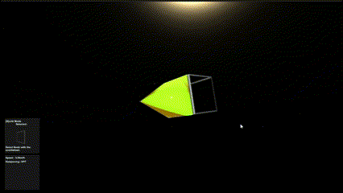

# Mothership

A Unity WIP project about node-based spaceships.



## About

Mothership is a spaceship builder and flight simulator where you construct modular vessels by connecting nodes together, then pilot your creations through space with physics-based flight.

## Features

- **Modular Ship Building**: Connect nodes (thrusters, panels, structural pieces) via typed port system
- **Physics-Based Flight**: Realistic thrust, mass, and inertia simulation
- **6-DOF Controls**: Full directional and rotational control of your ship
- **Dynamic Ship Breakage**: Ships can break apart when nodes are destroyed
- **Procedural Asteroid Field**: Environment with physics-enabled asteroids

## Tech Stack

- Unity 2021.3.10 LTS
- C# with Unity New Input System
- 3D Rigidbody physics

## Controls

### Flight Mode
- **WASD**: Thrust forward/back/strafe
- **Space/Ctrl**: Thrust up/down
- **Mouse**: Pitch/Yaw
- **Q/E**: Roll

### Build Mode
- **Left Click**: Place node
- **Right Click**: Remove node
- **Scroll**: Rotate node
- **Tab**: Switch port selection

## Project Structure

```
Assets/
├── Code/           # Core game systems
│   ├── Ship/       # Ship physics and construction
│   └── Nodes/      # Node types and connections
├── Player/         # Input handling and UI
├── Resources/      # Prefabs and meshes
└── Scenes/         # Game scenes
```

## Key Systems

- **Node System**: Modular components with typed connection ports
- **Construct System**: Base for any node-based object that can break apart
- **Ship Controller**: Flight physics with PID-controlled rotation
- **Orbit Camera**: Free camera system for building and flying

## For AI Agents

See [AGENTS.md](AGENTS.md) for detailed documentation on the codebase architecture and systems.
